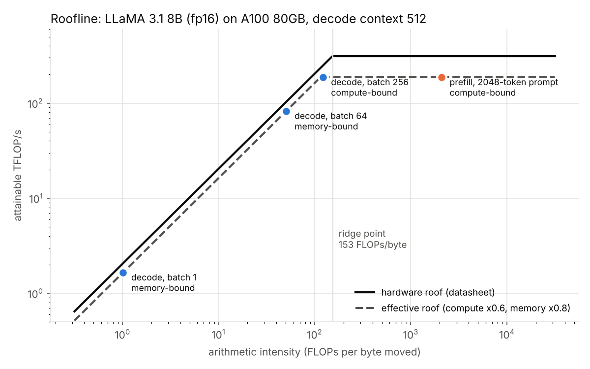
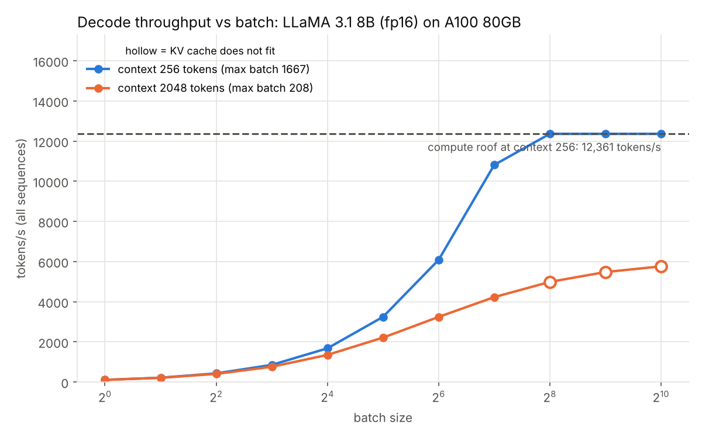
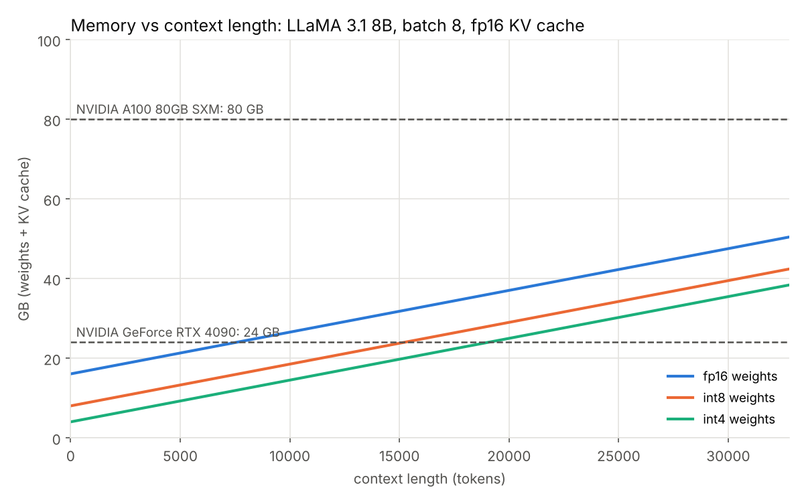

# llm-inference-perf

[](https://github.com/Hmzaah/llm-inference-perf/actions/workflows/ci.yml)

A small Python tool that estimates how fast a large language model runs on a given GPU,
using only the model's shape and the GPU's datasheet numbers (memory bandwidth, peak compute, memory size).

It answers questions like:

- Does LLaMA 3.1 8B fit on an RTX 4090 at 8k context, and with what batch size?
- How long does a 2048-token prompt take (prefill), and how many tokens/s does generation (decode) reach?
- Is each phase limited by compute or by memory bandwidth?
- What do batching and 8-bit / 4-bit weights change?

It is a roofline model: simple enough to check by hand, and honest about where it is wrong
(see [Validation](#validation-against-published-numbers)).

Supported models (dense, decoder-only): **LLaMA 3.1 8B, Qwen2.5 7B, DeepSeek-R1-Distill-Qwen-7B**, plus LLaMA 2 7B
(used only because the public llama.cpp benchmark runs it).
Built-in GPUs: **NVIDIA A100 80GB SXM, H100 SXM, RTX 4090, Intel Gaudi 2**, or any GPU you describe with `--gpu custom`.

## Quick start

**Linux / macOS**

```bash
python3 -m venv .venv
.venv/bin/python -m pip install -e ".[dev]"
.venv/bin/python -m llmperf estimate --model llama-3.1-8b --gpu a100-80gb --batch 8 --seq-len 2048 --precision int4
```

**Windows (PowerShell)**, no venv activation needed:

```powershell
py -3.12 -m venv .venv
.\.venv\Scripts\python -m pip install --isolated -e ".[dev]"
.\.venv\Scripts\python -m llmperf estimate --model llama-3.1-8b --gpu a100-80gb --batch 8 --seq-len 2048 --precision int4
```

(`--isolated` makes pip ignore any extra package indexes set in your pip config.)

Real output of the command above:

```
LLaMA 3.1 8B on NVIDIA A100 80GB SXM | batch 8 | context 2048 | weights int4 | KV fp16 | math fp16
efficiency: compute 0.6, memory 0.8 (assumptions)

metric                                value                    
---------------------------------------------------------------
weights                               4.02 GB                  
KV cache                              2.15 GB                  
fits in memory                        yes (80 GB x 0.9 usable) 
max batch at this context             253                      
prefill time (= time to first token)  1360.7 ms (compute-bound)
decode time per step                  3.62 ms (memory-bound)   
decode tokens/s (whole batch)         2211.8                   
decode tokens/s per sequence          276.5                    
prefill intensity                     43173.6 FLOPs/byte       
decode intensity                      21.8 FLOPs/byte          
GPU ridge point                       153.0 FLOPs/byte         
```

Prefill here processes all 8 prompts (8 x 2048 tokens) in one pass.

Other commands:

```bash
python -m llmperf list                                   # models and GPUs with their numbers
python -m llmperf sweep --model qwen2.5-7b --gpu h100-sxm --seq-len 4096          # tokens/s vs batch size
python -m llmperf quant --model llama-3.1-8b --gpu rtx-4090 --seq-len 4096        # fp16 vs int8 vs int4
python -m llmperf estimate --gpu custom --memory-gb 16 --bandwidth-gb-s 448 --fp16-tflops 50 --int8-tops 100
python -m llmperf plots                                  # writes docs/figures/*.png
python scripts/validate.py                               # compares with published benchmarks
```

## How it works: every formula, with a worked example

All the math is in [`src/llmperf/calc.py`](src/llmperf/calc.py), one function per formula.
The worked example is **LLaMA 3.1 8B, INT4 weights, FP16 KV cache, batch 1, 1024 tokens of context, on an A100 80GB**.
Shape (from Meta's official config): 32 layers, hidden size 4096, 32 query heads, 8 KV heads, head dim 128,
MLP width 14336, vocabulary 128256.

**1. Parameter count** (`count_params`). Per layer: the q and o projections (4096 x 4096 each), the k and v
projections (4096 x 1024 each, because only 8 KV heads x 128), the three SwiGLU MLP matrices (3 x 4096 x 14336)
and two norm vectors. Plus the input embedding and the output layer (128256 x 4096 each).
Result: **8,030,261,248** parameters. The unit tests check this and also check Qwen2.5 7B against its model card
(7.61B total, 6.53B non-embedding).

**2. Weight memory** (`weight_bytes`) = parameters x bytes per parameter.
FP16 = 2 bytes, INT8 = 1, INT4 = 0.5. Example: 8.03e9 x 0.5 = **4.02 GB**.
(llama.cpp formats also store a scale per block of 32 weights: Q4_0 = 0.5625 bytes, Q8_0 = 1.0625 bytes.)

**3. KV cache** (`kv_cache_bytes`) = 2 (K and V) x layers x KV heads x head dim x tokens x batch x bytes.
Per token: 2 x 32 x 8 x 128 x 2 bytes = 131,072 bytes (128 KiB). For 1024 tokens: **134 MB**.
Because of grouped-query attention (8 KV heads instead of 32), this is 4x smaller than it would otherwise be.

**4. FLOPs per token** (`flops_per_token`) = 2 x (weights used in matrix multiplies) + attention term.
Each weight does one multiply and one add per token, hence the 2. The input embedding is a table lookup, so it is
left out: 2 x (8,030,261,248 - 525,336,576) = 15.01 GFLOPs.
The attention term is 4 x layers x query heads x head dim x context (scores q.k plus the weighted sum of v, each
2 FLOPs per element): 4 x 32 x 32 x 128 x 1024 = 0.54 GFLOPs. Total **15.55 GFLOPs** per token.
For a whole prompt of S tokens (`prefill_flops`), token t only attends to t earlier tokens, so the attention part
uses S x (S + 1) / 2 instead of S x context.

**5. Roofline** (`roofline`). For any piece of work:

```
compute_time = FLOPs / (peak FLOP/s x compute_efficiency)
memory_time  = bytes moved / (memory bandwidth x memory_efficiency)
time         = max(compute_time, memory_time)       # the slower one is the bottleneck
arithmetic intensity = FLOPs / bytes moved
ridge point  = peak FLOP/s / bandwidth              # A100 FP16: 312e12 / 2039e9 = 153 FLOPs/byte
```

A phase whose intensity is below the ridge point is memory-bound, above it compute-bound.

**6. Decode time per token** (`decode_step`). One step makes one new token for every sequence in the batch.
It must read every weight once (shared by the batch) plus each sequence's KV cache.
Example: bytes = 7.50e9 x 0.5 + 134 MB = 3.89 GB. FLOPs = 15.55 GFLOPs. Intensity = **4 FLOPs/byte**, far below 153.
memory_time = 3.89e9 / (2039e9 x 0.8) = **2.38 ms**; compute_time = 15.55e9 / (312e12 x 0.6) = 0.08 ms.
So decode is memory-bound: about **420 tokens/s** (525 tokens/s if the full datasheet bandwidth were reached).

**7. Prefill time** (`prefill`). The whole prompt goes through in one pass, so the weights are read once for
1024 tokens and the intensity is huge. Example: 15.6 TFLOPs / (312e12 x 0.6) = **83.6 ms**, compute-bound.
This is also the time to the first output token.

**8. Batching** (`batch_sweep`, `max_batch`). Batch B multiplies decode FLOPs by B but the weight bytes stay the
same, so intensity grows roughly like B and tokens/s rise almost linearly until either the compute roof is hit or
the KV cache (which grows with B) dominates the bytes. Max batch = (usable memory - weights) / KV cache per sequence.
Example: (0.9 x 80 GB - 4.02 GB) / 134 MB = **506** sequences at 1024 tokens.

**9. Quantization** (`quant` command). Fewer bytes per weight means less memory, faster decode (fewer bytes to
stream) and more room for KV cache, so a larger max batch. Which compute peak is used depends on the format:

| `--precision` | bytes/weight | math used for matmuls (default) | why |
|---|---|---|---|
| fp16 / bf16 | 2 | FP16 | plain 16-bit |
| int8 | 1 | INT8 | assumes W8A8 (weights and activations 8-bit) |
| fp8 | 1 | FP8 | H100 / Gaudi 2 FP8 |
| int4 | 0.5 | FP16 | assumes W4A16 (GPTQ/AWQ style): weights are unpacked to 16-bit, so INT4 saves memory but not compute |
| q8_0 / q4_0 | 1.0625 / 0.5625 | INT8 | llama.cpp block formats; its quantized kernels use INT8 dot products |

Override with `--compute-dtype`. The KV cache precision is separate (`--kv-precision`, default fp16).

### Efficiency factors (assumptions, always visible)

No real program reaches datasheet peaks. Two factors scale them, and both are CLI flags:

| flag | default | meaning |
|---|---|---|
| `--compute-eff` | 0.6 | fraction of peak tensor-core FLOP/s that large matrix multiplies reach |
| `--memory-eff` | 0.8 | fraction of peak memory bandwidth reached when streaming weights and KV cache |
| `--usable-memory` | 0.9 | fraction of GPU memory available for weights + KV cache (the rest: activations, runtime, fragmentation) |

The defaults were chosen before running the validation below and were not fitted to it. They are the biggest
source of error in the tool: change them and every time scales directly.

## Figures

Generated with `python -m llmperf plots`.



Decode at batch 1 sits far down the bandwidth slope; prefill sits on the compute roof. Batching moves decode
right along the slope until it reaches the roof.



At 256 tokens of context, throughput rises with batch until it hits the compute roof. At 2048 tokens the KV cache
traffic grows with the batch as fast as the useful work, so decode stays memory-bound and the KV cache fills memory
(max batch 208) long before the compute roof.



Quantizing weights shifts the line down by a fixed amount; the KV cache slope (the same for all three) is what
eventually limits long contexts.

## Validation against published numbers

All measured values are copied from the sources linked; the raw data with hardware, model, precision and batch is in
[`validation/benchmarks.json`](validation/benchmarks.json). Run `python scripts/validate.py` to reproduce this table
(it writes [`validation/results.md`](validation/results.md)). Error = (estimate - measured) / measured,
so positive means the tool is too optimistic. Default efficiency factors throughout.

**Decode, llama.cpp `llama-bench` tg128, LLaMA 2 7B Q4_0, batch 1, FP16 KV cache**
Source: [llama.cpp discussion #15013, "Performance of llama.cpp on Nvidia CUDA"](https://github.com/ggml-org/llama.cpp/discussions/15013) (flash-attention-on rows).

| GPU (as listed in the source) | measured tok/s | estimate tok/s | error | implied bandwidth efficiency |
|---|---|---|---|---|
| RTX 4090, 24 GB GDDR6X | 189.0 | 215.0 | +14% | 70% |
| A100 80 GB, HBM2e (form factor not stated) | 200.9 | 435.0 | +117% | 37% |
| H100 80 GB, HBM3 (SXM) | 280.7 | 714.7 | +155% | 31% |

**Prefill, same runs (pp512, 512-token prompt, batch 1)**

| GPU | measured tok/s | estimate (INT8 math) | error | estimate (FP16 math) | error |
|---|---|---|---|---|---|
| RTX 4090 | 14771 | 29692 | +101% | 7425 | -50% |
| A100 80GB | 5286 | 28047 | +431% | 14023 | +165% |
| H100 SXM | 11263 | 88949 | +690% | 44475 | +295% |

**End-to-end throughput, Intel Gaudi 2, LLaMA 3.1 8B FP8, 1 card, Optimum-Habana (Gaudi software 1.20.0)**
Source: [Intel, Model Performance Data for Intel Gaudi 2, inference](https://intel.cn/content/www/cn/zh/developer/platform/gaudi/model-performance-gaudi2-inference.html).
The page does not state the KV cache type; FP8 is assumed because a 16-bit cache at batch 512 x 2176 tokens would
need 146 GB, more than the card has.

| batch | input tokens | output tokens | measured tok/s | estimate tok/s | error |
|---|---|---|---|---|---|
| 2816 | 128 | 128 | 19907 | 17279 | -13% |
| 512 | 128 | 2048 | 14866 | 19986 | +34% |
| 179 | 2048 | 128 | 2099 | 1753 | -17% |
| 256 | 2048 | 2048 | 6060 | 6776 | +12% |

**What this shows, in plain words**

- **Large-batch serving (Gaudi 2) is predicted within -17% to +34%.** At these batch sizes the work really is limited
  by the matrix engines or by streaming the KV cache, which is what the roofline describes. The worst case is the
  long-output run (512 x 2048 generated tokens), where decode reads a large, paged KV cache; real attention kernels
  read it less efficiently than one big stream, and the attention math may not run at FP8 speed.
- **Batch-1 decode on the RTX 4090 is close (+14%)**, but on the A100 and H100 the tool is 2-2.5x too optimistic.
  The measurements themselves show why: the A100 has twice the 4090's bandwidth yet generates about the same
  tokens/s. At batch 1 a 7B Q4_0 model is only ~3.8 GB, so at full bandwidth one token would take 1-2 ms on these
  GPUs, and fixed costs per token (many small kernels per layer across 32 layers, synchronization, matrices too
  small to keep HBM busy) become a large share of that time. A pure bandwidth model has no term for that. Read the last column as the achieved
  fraction of datasheet bandwidth: 70% on the 4090, about a third on the datacenter GPUs in this setup.
- **llama.cpp prefill is not predicted well.** Which kernel path ran (INT8 dot products or FP16 cuBLAS) changes the
  estimate by 2x, and the measurements show llama.cpp reaches a small fraction of A100/H100 tensor-core peak
  (the H100 prompt speed is below the RTX 4090's). The tool predicts what the hardware allows, not what a
  particular engine achieves.
- Smaller effects: the `q4_0` setting assumes every tensor is stored at exactly 4.5 bits per weight, while a real
  file can mix tensor types (the compare script below uses the real file size instead), and the A100 in the
  llama.cpp table may be the PCIe version, which has lower bandwidth than the SXM numbers used here.

### Measure your own GPU

[`scripts/llama_bench_compare.py`](scripts/llama_bench_compare.py) compares a `llama-bench` run with the estimate.
It reads the real bytes per weight from the file, so any GGUF quantization works.

1. Download a prebuilt llama.cpp release for your GPU from <https://github.com/ggml-org/llama.cpp/releases>
   (on Windows with an NVIDIA GPU, the `win-cuda` zip, plus the matching `cudart` zip if listed).
2. Download the same model file as the public scoreboard:
   `llama-2-7b.Q4_0.gguf` (3.83 GB) from <https://huggingface.co/TheBloke/Llama-2-7B-GGUF>.
   **On a 4 GB GPU use `llama-2-7b.Q2_K.gguf` (2.83 GB) from the same repo instead**: Q4_0 plus the KV cache and
   CUDA buffers will not fit, and if some layers fall back to the CPU the result no longer measures the GPU.
   Any GGUF of LLaMA 3.1 8B or Qwen2.5 7B also works; pass the matching `--model`.
3. Run the benchmark and save JSON (PowerShell):
   ```powershell
   .\llama-bench.exe -m llama-2-7b.Q4_0.gguf -ngl 99 -o json > my_llama_bench.json
   ```
4. Compare, giving your GPU's dense (not sparse) peaks:
   ```powershell
   .\.venv\Scripts\python scripts\llama_bench_compare.py my_llama_bench.json --model llama-2-7b --gpu custom `
       --memory-gb 8 --bandwidth-gb-s 272 --fp16-tflops 22 --int8-tops 88
   ```
   (The four numbers are only an example; replace them with your GPU's values.)

**If your GPU's datasheet doesn't list bandwidth or tensor TFLOPS** (common for laptop GPUs), derive them from
`nvidia-smi --query-gpu=name,memory.total,clocks.max.sm,clocks.max.memory --format=csv` and the architecture:

- Bandwidth (GB/s) = bus width in bits / 8 x memory data rate in Gbps. Check: RTX 4090, 384 / 8 x 21 = 1008 GB/s,
  as in the Ada whitepaper. On GeForce cards with GDDR6/GDDR6X, `nvidia-smi` usually reports a memory clock equal
  to half the data rate, so data rate (Gbps) = 2 x clocks.max.memory (MHz) / 1000. This is a convention, not a
  datasheet value, so cross-check it with your laptop maker's spec sheet or GPU-Z if you can.
- Ada (RTX 40 series) tensor peaks per SM per clock, worked out from the whitepaper's RTX 4090 numbers
  (165.2 TFLOPS / (128 SMs x 2.52 GHz) = 512): **512 FP16 FLOPs (FP32 accumulate) and 2048 INT8 ops**.
  Peak = SMs x that number x max SM clock. An Ada SM has 128 CUDA cores, so SMs = CUDA cores / 128.
- Laptop GPUs rarely hold their max clock under load (the clock depends on the power limit and cooling), so these
  peaks are upper bounds. Note this when you read the error.

## Data sources

Every number in [`src/llmperf/data/models.json`](src/llmperf/data/models.json) and
[`src/llmperf/data/gpus.json`](src/llmperf/data/gpus.json) has its source URL next to it.

| entry | source | note |
|---|---|---|
| LLaMA 3.1 8B | [Meta llama-models `sku_list.py`](https://github.com/meta-llama/llama-models/blob/0e0b8c519242d5833d8c11bffc1232b77ad7f301/models/sku_list.py) | Hugging Face config is gated; Meta's own repo used instead |
| Qwen2.5 7B | [config.json](https://huggingface.co/Qwen/Qwen2.5-7B/blob/main/config.json), [model card](https://huggingface.co/Qwen/Qwen2.5-7B) | |
| DeepSeek-R1-Distill-Qwen-7B | [config.json](https://huggingface.co/deepseek-ai/DeepSeek-R1-Distill-Qwen-7B/blob/main/config.json) | dense Qwen2 model, not the MoE DeepSeek V3 |
| LLaMA 2 7B | [LLaMA paper](https://arxiv.org/pdf/2302.13971v1), [Llama 2 paper](https://arxiv.org/pdf/2307.09288) | shape confirmed by exact parameter count |
| A100 80GB SXM | [NVIDIA datasheet](https://www.nvidia.com/content/dam/en-zz/Solutions/Data-Center/a100/pdf/a100-80gb-datasheet-update-a4-nvidia-1485612-r12-web.pdf) | dense 312 TFLOPS FP16; 624 is the sparse figure |
| H100 SXM | [NVIDIA H100 page](https://www.nvidia.com/en-us/data-center/h100/) | NVIDIA lists sparse figures; dense = half |
| RTX 4090 | [NVIDIA Ada architecture whitepaper](https://images.nvidia.com/aem-dam/Solutions/Data-Center/l4/nvidia-ada-gpu-architecture-whitepaper-v2.1.pdf) | FP16 with FP32 accumulate (165.2) used |
| Intel Gaudi 2 | [Gaudi 2 whitepaper](https://habana.ai/wp-content/uploads/pdf/2022/gaudi2-whitepaper.pdf), [Gaudi 3 white paper, Table 1](https://cdrdv2-public.intel.com/817486/gaudi-3-ai-accelerator-white-paper.pdf) | Intel does not say dense or sparse; treated as dense |

## Limitations

- **Single GPU only.** No tensor, pipeline or data parallelism and no interconnect model yet.
- **Dense models only.** No mixture-of-experts (DeepSeek V2/V3, Mixtral), no multi-head latent attention.
- **Efficiency factors are assumptions**, one number per GPU for all kernels. Real efficiency depends on matrix
  sizes, the inference engine and the kernel used (see the validation results).
- No per-token fixed overhead (kernel launches, CPU scheduling), so small models at batch 1 on fast GPUs come out
  too fast.
- Activations, softmax, norms and RoPE are ignored in both FLOPs and bytes; they are small next to the matmuls.
- Paged attention, continuous batching, speculative decoding and prefix caching are not modelled. Decode assumes
  every sequence in the batch has the same context length.
- GB means 10^9 bytes everywhere, like the datasheets.

## Project layout

```
src/llmperf/calc.py          all formulas (start here)
src/llmperf/specs.py         loads the JSON tables
src/llmperf/data/*.json      model and GPU numbers with source URLs
src/llmperf/cli.py           command line interface
src/llmperf/plots.py         figures
tests/                       unit tests with hand-calculated values
scripts/validate.py          comparison with published benchmarks
scripts/llama_bench_compare.py   compare with your own llama-bench run
docs/explain-like-im-interviewing.md   concepts and interview Q&A
```

## License

MIT
